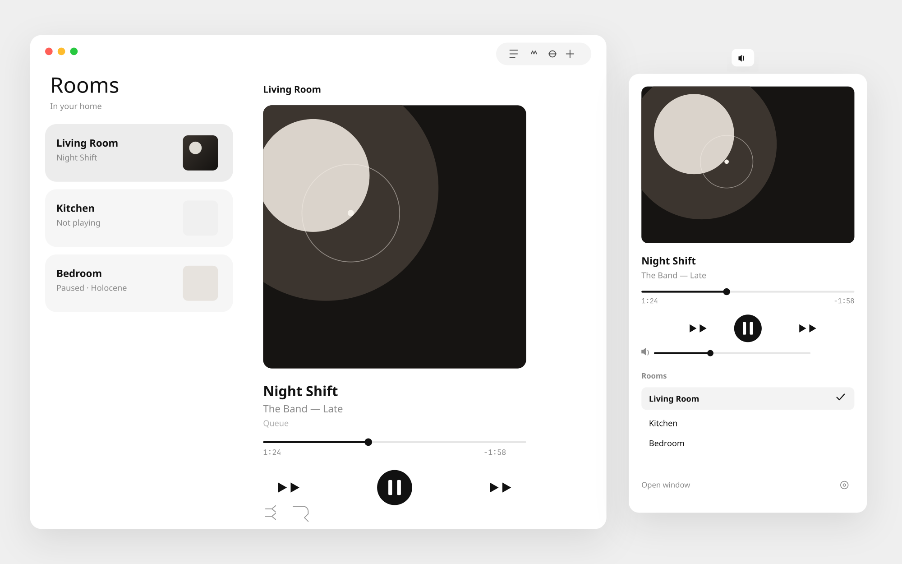

# Sonos Local

A native, local-only Sonos controller for macOS.

[](https://github.com/dbendaou/sonos-local)
[](https://swift.org)
[](LICENSE)
[](#what-the-local-api-cannot-do)

<p align="center">
  
</p>

It replaces the old Sonos desktop app on Apple Silicon: discovery, playback, volume, grouping, queue, favorites, and the settings the speakers expose locally. There is no Sonos account, no telemetry, and no server in the middle.

The window follows the current Sonos iOS app: large artwork, quiet type, room cards, and plenty of space. The menu bar is a full controller. Run it beside the Dock, or as a menu-bar-only app.

Sonos Local is an independent project. It is not affiliated with Sonos, Inc.

## What it does

- Finds speakers with SSDP (`ZonePlayer:1` on `239.255.255.250:1900`) and, on macOS, Bonjour `_sonos._tcp`.
- Reads the household from `GetZoneGroupState` and shows rooms as cards. Bonded subs, surrounds, and the right side of a stereo pair stay hidden.
- Now playing: artwork, title, artist, album, source, play / pause / next / previous, seek, shuffle, repeat, crossfade, sleep timer.
- Group volume and mute on the coordinator, plus each room’s own volume when you group.
- Group and ungroup rooms. Leaving with the coordinator still selected hands coordination to another room first.
- Queue: play a row, reorder, remove, clear.
- Library sheet: Sonos favorites (`FV:2`), playlists (`SQ:` and `A:PLAYLISTS`), line-in and TV (`AI:`), saved radio (`R:0/0`). Play, play next, or add to the queue.
- Room settings read from the speaker: name, bass, treble, loudness, fixed output, Trueplay on/off, night mode, speech enhancement, surround and sub levels, height, audio delay, status light, button lock, alarms, and system info.
- Event subscriptions on AVTransport, RenderingControl, and ZoneGroupTopology, with polling underneath so a missed notify doesn’t freeze the UI.
- Menu bar popover: artwork, transport, volume, and room switching. Settings → **Menu bar only** hides the Dock icon (`LSUIElement`-style activation policy) and keeps the popover.

Album art is loaded from the speaker. If the metadata points at a public CDN, the app asks the speaker’s `/getaa` proxy instead of fetching that host itself.

## What the local API cannot do

These need the official mobile app or a Sonos account. They are not stubbed, and they are not going to be added by calling out to the cloud.

| Not available here | Why |
| --- | --- |
| Sign in to Spotify, Apple Music, Amazon Music, and other services | OAuth and service sessions are cloud flows. |
| Browse a service catalog | SMAPI browsing needs the service session stored for the household and often leaves the LAN. |
| Create a Trueplay tuning | The measurement uses the phone microphone. An existing tuning can be enabled or disabled locally (`SetRoomCalibrationStatus`). |
| Voice assistant setup | Account linking. |
| Firmware updates | The player downloads them from Sonos. |
| Register a system or manage a Sonos account | Cloud only. |
| Stereo-pair and surround bonding | The calls exist (`CreateStereoPair`, `AddHTSatellite`) but a mistake hides a speaker. They are intentionally not in the UI. |

Speakers will still play services that are already linked. Favorites, playlists, the queue, line-in, and TV use the URI the speaker already knows.

## Requirements

- macOS 14 or later, including macOS 26. Apple Silicon or Intel.
- Swift 5.9 or later. Command Line Tools are enough; a full Xcode install is optional. Apple Swift 6.4 works.
- Speakers on the same LAN as the Mac, reachable on port 1400

The app’s deployment target is macOS 14. Swift 6 would otherwise compile it for macOS 12, which cannot see the SwiftUI APIs it uses.

The protocol module has no Apple-only dependencies, so `swift test` also runs on Linux.

## Build and run

Open `Package.swift` in Xcode and run the `SonosLocal` scheme.

From the terminal, on a Mac:

```bash
swift test
swift build --product SonosLocal
swift run --product SonosLocal
```

To get a normal app bundle (Dock icon, Finder launch):

```bash
make app
open "build/Sonos Local.app"
```

The first launch on macOS may ask for local network access. That permission is what lets SSDP and Bonjour see speakers. Control traffic is HTTP to the speaker on port 1400 only.

### Menu bar only

Sonos Local → Settings → Menu Bar → **Menu bar only**.

The Dock icon goes away and the main window closes. The menu bar icon still has playback, volume, and rooms. **Open window** brings the window back without turning the Dock icon on. Turn the setting off to return to a normal app.

## Project layout

```
Sources/SonosKit     SSDP, SOAP, device and zone XML, DIDL, events, speaker calls
Sources/SonosApp     SwiftUI window, menu bar, settings
Tests/SonosKitTests  Protocol tests, including a loopback event-server test
Scripts/build-app.sh Wraps the release binary in Sonos Local.app
```

`SonosKit` is the boundary. The app never builds SOAP itself.

## Design

Light mode is white. Dark mode is black. Room cards are soft gray rectangles with the room name, what’s playing, and a small piece of art. The now-playing column is a single large cover, a thin scrubber, a circular play button, and a thin volume slider. Controls that aren’t needed for the current gesture stay quiet.

The menu bar uses the same pieces at a smaller size, with the room list under the transport.

## Development

```bash
swift test
```

CI is `.github/workflows/ci.yml`. It runs on `macos-14`, tests the protocol module, and builds `SonosLocal`.

If you change an action, a parser, or a URI, add a fixture in `Tests/SonosKitTests`. See [CONTRIBUTING.md](CONTRIBUTING.md).

## Verification

Protocol tests cover XML, SOAP envelopes and faults, device descriptions, zone groups (including the escaped XML Sonos returns), DIDL metadata, event `LastChange`, alarms, SSDP responses, play-mode mapping, seek time formatting, queue reorder indexes, local-only artwork URLs, and the notify server on loopback.

Playback against real speakers was not run in the environment that produced this tree (it is not a Mac, and there is no speaker on its network). The SwiftUI app is compile-ready for Xcode 15 / macOS 14 and was not executed there. On a Mac, `swift test` and `swift build --product SonosLocal` are the checks to run, then point the app at a household.

## License

[MIT](LICENSE)
